<!-- ═══════════════════════════════ HEADER ═══════════════════════════════ -->
<div align="center">


<a href="https://git.io/typing-svg">
  
</a>

<br/>

<a href="https://github.com/DeltaAT"></a>

<a href="https://github.com/DeltaAT?tab=repositories"></a>

</div>


## `> whoami`

<table>
  <tr>
    <td width="42%" align="center">
      
    </td>
    <td width="58%">

```text
deltaat@github
──────────────────────────────────────
Role ....... Full-Stack Dev
             ML Explorer · Student
Languages .. Python · TypeScript
             C++ · Rust
Interests .. AI/ML · Systems
             Web Apps · Open Source
Currently .. building something awesome
Debugger ... print(), unashamed
Uptime ..... always learning,
             always shipping
```

</td>
  </tr>
</table>

<details>
<summary><b>🐍 <code>cat developer.py</code></b> — the source code of me</summary>

<br/>

```python
class Developer:
    def __init__(self):
        self.name        = "DeltaAT"
        self.role        = ["Full-Stack Dev", "ML Explorer", "Student"]
        self.languages   = ["Python", "TypeScript", "C++", "Rust"]
        self.interests   = ["AI/ML", "Systems", "Web Apps", "Open Source"]
        self.currently   = "Building something awesome 🔧"
        self.fun_fact    = "I debug with print() and I'm not ashamed 🐛"

    def say_hi(self):
        print("Thanks for stopping by! Let's build something great together.")

me = Developer()
me.say_hi()
```

</details>


## `> ls ~/arsenal`

<div align="center">

<table>
  <tr>
    <td align="center" width="25%"><b>💻 Languages</b></td>
    <td align="center"><a href="https://skillicons.dev"></a></td>
  </tr>
  <tr>
    <td align="center"><b>🌐 Web</b></td>
    <td align="center"><a href="https://skillicons.dev"></a></td>
  </tr>
  <tr>
    <td align="center"><b>🤖 AI / ML</b></td>
    <td align="center">
      <a href="https://skillicons.dev"></a><br/>
      
      
      
      
      
    </td>
  </tr>
  <tr>
    <td align="center"><b>⚙️ Tools & DevOps</b></td>
    <td align="center"><a href="https://skillicons.dev"></a></td>
  </tr>
</table>

</div>


## `> git log --stats`

<div align="center">


<a href="https://git.io/streak-stats">
  
</a>

</div>


## `> cat quests.log`

| Status | Quest | Objective |
|:---:|:---|:---|
| 🟥 **ACTIVE** | 🧠 Deep Learning & Neural Architectures | Go beyond the API — understand what's inside the black box |
| 🟥 **ACTIVE** | ⚡ Rust for Systems Programming | Fearless concurrency, zero-cost everything |
| 🟥 **ACTIVE** | ☁️ Cloud & MLOps | Deploy ML models at scale, not just in notebooks |


## `> ./connect.sh`

<div align="center">

<a href="https://github.com/DeltaAT"></a>

<br/><br/>

<!-- Snake is generated by .github/workflows/snake.yml into the `output` branch -->
<picture>
  <source media="(prefers-color-scheme: dark)" srcset="https://raw.githubusercontent.com/DeltaAT/DeltaAT/output/github-snake-dark.svg" />
  <source media="(prefers-color-scheme: light)" srcset="https://raw.githubusercontent.com/DeltaAT/DeltaAT/output/github-snake.svg" />
  
</picture>

</div>

<!-- ═══════════════════════════════ FOOTER ═══════════════════════════════ -->
<div align="center">


</div>
